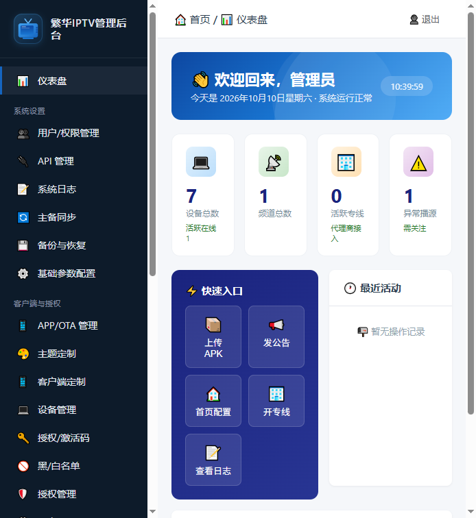
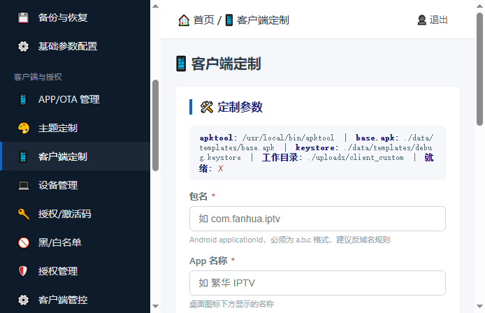
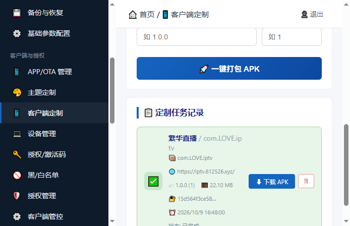

# 📺 IPTV Web Admin

**All-in-one IPTV management backend: live sources, channels/EPG, device licensing, statistics, and one-click custom APK building — shipped as a multi-arch Docker image.**

[中文文档](README.md) · [Changelog](CHANGELOG.md)

## ✨ Features

| Module | What it does |
|--------|--------------|
| Live sources | Grouping, bulk m3u import, availability probing, custom User-Agent, line priority |
| Channels | CRUD, category grouping, EPG attachment, bulk operations |
| EPG | Programme data source config, scheduled fetch, guide display |
| Devices | Activation-code licensing, heartbeat online status, last-seen time, IP geolocation |
| Statistics | Device/online trends, geographic TOP 10 (ip2region, province-level), activity dashboard |
| API secrets | Multiple secrets, per-channel distribution for third-party integrations |
| Notices | Client announcements (including pop-up), pulled on APK start |
| APK builder | Set package name / app name / backend URL / icon → generate a branded APK in one click |
| Backup | One-click DB backup from the admin panel, restorable on failure |
| Security | Operation logs, JWT auth, password change from the admin UI |

## 🚀 Quick start

```bash
docker run -d \
  --name iptvweb \
  --restart unless-stopped \
  -p 9627:9627 \
  -v iptvweb_data:/app/data \
  -v iptvweb_uploads:/app/uploads \
  656688515/iptvweb:latest
```

Open **http://YOUR_SERVER_IP:9627** and sign in.

Or with compose:

```bash
curl -O https://raw.githubusercontent.com/300737/iptvweb-release/main/docker-compose.yml
docker compose up -d
```

### Default credentials

| Field | Value |
|-------|-------|
| URL | `http://YOUR_SERVER_IP:9627` |
| Username | `admin` |
| Password | `admin123` |

Change the password right after the first login (**avatar → Change password**).

Prefer to set your own at first boot? These two env vars apply only during the very first initialization:

```
IPTV_SYSTEM_DEFAULT_ADMIN_USERNAME
IPTV_SYSTEM_DEFAULT_ADMIN_PASSWORD
```

## 🖼 Screenshots







## 📦 Custom APK pipeline

No Android Studio, no local JDK — the image bundles everything.

```
Params ──▶ apktool decode ──▶ rewrite package/app name ──▶ rebuild ──▶ apksigner ──▶ download
```

JDK 17, apktool, zipalign, a signing keystore and the base APK template are all baked in.
On arm64 hosts the native zipalign is used automatically.

## 🗂 Persistence

| Volume | Mount | Contents |
|--------|-------|----------|
| `iptvweb_data` | `/app/data` | SQLite DB + build templates (base.apk / apktool.jar / keystore) |
| `iptvweb_uploads` | `/app/uploads` | Generated APKs, uploaded icons, logs, backups |

## 🧰 Operations

```bash
docker logs -f iptvweb
docker restart iptvweb

# upgrade (volumes keep your data)
docker pull 656688515/iptvweb:latest
docker rm -f iptvweb
docker run -d --name iptvweb --restart unless-stopped \
  -p 9627:9627 \
  -v iptvweb_data:/app/data \
  -v iptvweb_uploads:/app/uploads \
  656688515/iptvweb:latest

# back up the data volume (stop the container first)
docker run --rm -v iptvweb_data:/data -v $(pwd):/backup alpine \
  tar czf /backup/iptvweb_data.tar.gz -C /data .
```

## 📌 Image facts

| Item | Value |
|------|-------|
| Image | `656688515/iptvweb:latest` |
| Base | `eclipse-temurin:17-jdk-jammy` |
| Architectures | `linux/amd64`, `linux/arm64` |
| Port | `9627` |
| Healthcheck | `GET /api/health` |

## ❓ FAQ

**"base.apk not found" when building** — templates are extracted at startup; `docker restart iptvweb`.

**Forgot the admin password** — the only reset path today is dropping the database, which **wipes all business data**. Back up first:

```bash
docker stop iptvweb
docker run --rm -v iptvweb_data:/data -v $(pwd):/backup alpine tar czf /backup/iptvweb_data_backup.tar.gz -C /data .
docker run --rm -v iptvweb_data:/data alpine rm -f /data/iptv.db
docker start iptvweb   # re-seeded with admin / admin123
```

**Does it run on ARM?** Yes — native multi-arch images since `v20261009k`. Same command, Docker picks the right layer.

## 🛠 Tech stack

Go 1.26 · Gin · GORM · SQLite (pure Go, no CGO) · JWT v5 · ip2region · Docker multi-arch build.
The Docker image additionally carries JDK 17 + apktool toolchain for APK customization.

## 📄 License

[MIT](LICENSE)
